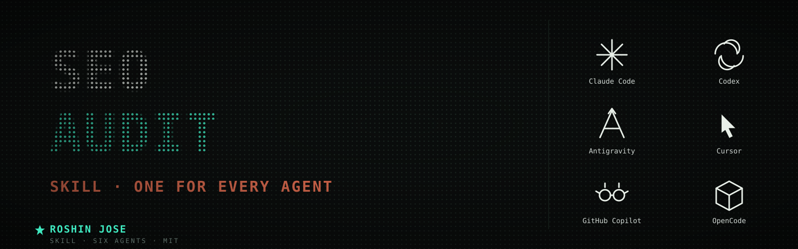

<p align="center">
  
</p>

# SEO Audit

>

**Author:** Roshin Jose · roshinjose1@gmail.com

A cross-tool AI agent skill. Works in Claude Code, OpenAI Codex, Google Antigravity, Cursor, GitHub Copilot, and OpenCode.

## Install (Claude Code)
```bash
git clone https://github.com/Roshinjose167/Awesome-SEO-Audit-Skill.git
cp -R Awesome-SEO-Audit-Skill/ ~/.claude/skills/seo-audit/
```
An agent loads the skill when the task matches its description, or invoke it by name.

## License
[MIT](LICENSE) © 2026 Roshin Jose.
